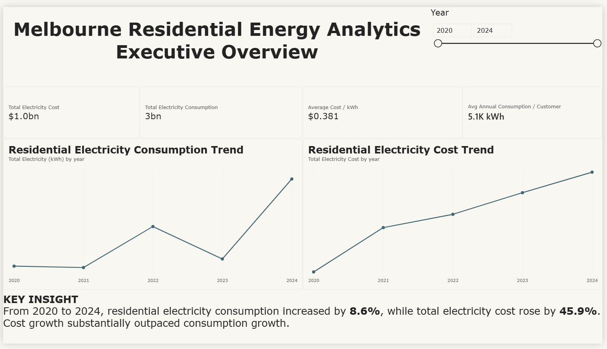
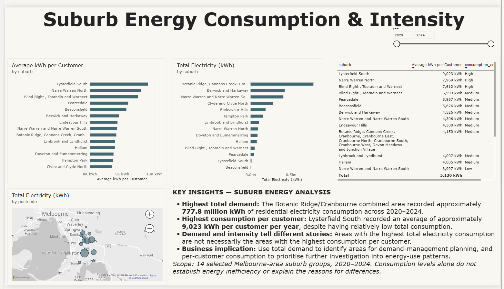
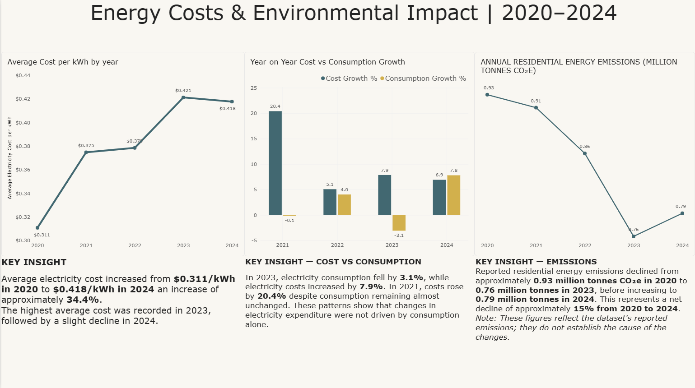
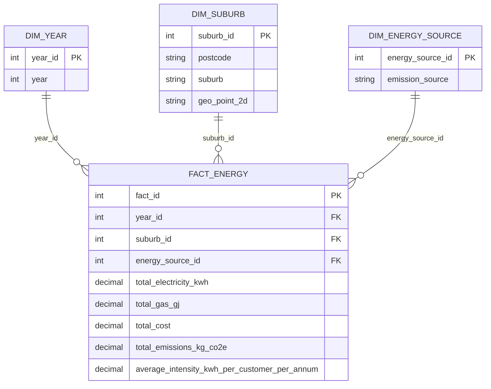

# Melbourne Residential Energy Analytics

An end-to-end data analytics project that examines residential energy consumption, cost, customer intensity, and emissions across selected Melbourne-area suburb groups from 2020 to 2024.

The project moves from raw CSV data through Python-based cleaning and exploratory analysis, a MySQL star schema and analytical SQL, and an interactive Power BI dashboard designed to support clear business decisions.

> **Portfolio note:** The analysis covers 14 selected suburb groups in the supplied dataset. Findings are descriptive; they show patterns in the data but do not establish the causes of energy use, price changes, or emissions changes.

## Dashboard preview

The Power BI report contains three pages:

1. **Executive Overview** — headline KPIs, annual electricity consumption, electricity cost, average cost per kWh, and customer consumption metrics.
2. **Suburb Analysis** — total consumption, consumption per customer, geographic comparison, and ranked suburb-level detail.
3. **Cost & Emissions Analysis** — changes in electricity cost, consumption, average unit cost, annual emissions, and written business insights.

### Executive Overview



### Suburb Analysis



### Cost & Emissions Analysis



## Business questions answered

- How did residential electricity consumption change between 2020 and 2024?
- How did total electricity cost change over the same period, and did costs grow faster than consumption?
- How did the effective average electricity cost per kWh change over time?
- Which suburb groups recorded the greatest total residential electricity demand?
- Are high-demand locations also the highest-consuming locations on a per-customer basis?
- Which locations have the highest annual electricity consumption per customer?
- How can suburb groups be segmented into high, medium, and low electricity-consumption intensity?
- How did total residential energy emissions change over time?
- What do total demand and per-customer intensity reveal when considered together?

## Key insights

- Residential electricity consumption increased by **8.6%** from 2020 to 2024, while total electricity cost increased by **45.9%**.
- Average electricity cost rose from approximately **$0.311/kWh in 2020** to **$0.418/kWh in 2024**, indicating that higher unit cost was an important driver of household electricity expenditure.
- The Botanic Ridge/Cranbourne combined area recorded approximately **777.8 million kWh** of residential electricity consumption across the period.
- Lysterfield South recorded the highest average annual electricity consumption per customer at approximately **9,023 kWh**, despite relatively low total demand.
- Reported residential energy emissions declined from approximately **0.93 million tonnes CO₂e in 2020** to **0.79 million tonnes CO₂e in 2024**, with the lowest point in 2023.

## Project workflow

```text
Raw CSV data
    ↓
Python cleaning, validation, and exploratory data analysis
    ↓
Processed residential-energy CSV
    ↓
MySQL staging table → dimensional model → analytical view
    ↓
SQL analysis and Power BI import
    ↓
Interactive Power BI dashboard and business insights
```

## Repository structure

```text
melbourne-energy-analytics/
├── code/
│   └── load_to_mysql.py                    # Loads cleaned CSV data into MySQL staging
├── data/
│   ├── raw/
│   │   └── summary-residential-community-data.csv
│   └── processed/
│       └── residential_energy_clean.csv
├── notebooks/
│   └── 01_data_cleaning_eda.ipynb          # Python cleaning and EDA
├── powerbi/
│   └── Melbourne_energy_analysis.pbix      # Interactive Power BI report
└── sql/
    ├── energy_analysis.sql                 # Schema, dimensions, fact table, and validation queries
    ├── energy_analysis-1.sql               # Alternative CSV import approach
    ├── 2.sql                               # Electricity consumption year-on-year analysis
    ├── 3.sql                               # Electricity cost year-on-year analysis
    ├── 4.sql                               # Suburb electricity-demand comparison
    ├── 5.sql                               # Consumption-intensity segmentation
    └── 6.sql                               # Consumption-intensity ranking and Power BI view
```

## Data scope

| Item | Coverage |
| --- | --- |
| Category analysed | Residential |
| Reporting period | 2020–2024 |
| Selected suburb groups | 14 |
| Energy sources | Electricity and gas |
| Clean analytical records | 140 |
| Raw source records | 224 |
| Geography fields | Suburb, postcode, point coordinates, and polygon geometry |

The processed dataset retains energy consumption, gas use, cost, emissions scopes, total emissions, per-customer intensity metrics, and geographic fields.

## Technical approach

### 1. Python data preparation and exploratory analysis

The notebook uses **pandas**, **NumPy**, **Matplotlib**, and **Seaborn** to:

- inspect the source dataset shape and columns;
- filter records to the Residential category;
- profile duplicate records, missing values, and data types;
- separate Electricity and Gas records for appropriate analysis;
- aggregate consumption, cost, and emissions by year and suburb;
- compare total electricity demand against average consumption per customer;
- calculate annual growth rates with `pct_change()`;
- create exploratory bar, line, and scatter charts.

### 2. MySQL data modelling and SQL analysis

The SQL workflow creates a star schema with `fact_energy` as the central fact table. Each record represents energy measures at the **year × suburb × energy-source** level.



The model separates reusable descriptive attributes from measures and supports consistent aggregation in SQL and Power BI.

The SQL analysis demonstrates:

- staging-table creation and CSV loading;
- dimensional modelling with primary keys, foreign keys, and a fact-table uniqueness constraint;
- `JOIN`, `GROUP BY`, `CASE`, `ROUND`, and aggregate functions;
- Common Table Expressions (CTEs);
- `LAG()` window functions for year-on-year growth;
- `RANK()` for suburb consumption-intensity ranking;
- creation of the `vw_energy_analysis` view for streamlined Power BI consumption.

### 3. Power BI dashboard development

The Power BI report includes:

- executive KPI cards for total electricity cost, total electricity consumption, average cost per kWh, and average annual consumption per customer;
- annual trend charts for consumption, cost, unit cost, growth, and emissions;
- suburb-level bar charts, map, ranking/detail table, and year slicers;
- calculated measures for totals, averages, growth rates, cost per kWh, and emissions conversion;
- written insight panels that translate the analysis into business-relevant observations;
- consistent dashboard layout and drill/filter interactions.

## Skills demonstrated

### Data analytics

- Exploratory data analysis (EDA)
- Data-quality checks and validation
- Data aggregation and descriptive analysis
- Trend, growth-rate, cost, intensity, and emissions analysis
- Geographic and suburb-level comparison
- Translating analytical results into decision-oriented insights

### Python

- pandas and NumPy data manipulation
- CSV input/output and data preparation
- Matplotlib and Seaborn for exploratory visualisation
- Grouping, aggregation, sorting, and percentage-change calculations

### SQL and databases

- MySQL database design and implementation
- Star-schema / dimensional-modelling concepts
- Staging, dimension, and fact tables
- Keys, relationships, constraints, and data loading
- Views for reporting consumption
- CTEs, window functions, ranking, conditional logic, and analytical SQL

### Business intelligence and communication

- Power BI report design
- DAX measures and metric formatting
- KPI, trend, comparison, table, map, and slicer design
- Dashboard storytelling and executive summary design
- Communicating limitations and avoiding unsupported causal claims

## How to run the project

### Prerequisites

- Python 3.x
- MySQL Server
- Power BI Desktop
- Python packages: `pandas`, `numpy`, `matplotlib`, `seaborn`, and `mysql-connector-python`

Install the Python packages:

```bash
pip install pandas numpy matplotlib seaborn mysql-connector-python
```

### Database setup

1. Open MySQL and run `sql/energy_analysis.sql` to create the database, staging table, dimensions, fact table, and validation queries.
2. Update the file path in `code/load_to_mysql.py` if your local project path differs.
3. Store database credentials in environment variables rather than the source file.
4. Run the loader script to import `data/processed/residential_energy_clean.csv` into `staging_energy`.
5. Run the remaining SQL scripts in `sql/` to reproduce the analyses and create `vw_energy_analysis`.

### Dashboard

1. Open `powerbi/Melbourne_energy_analysis.pbix` in Power BI Desktop.
2. Refresh the MySQL connection if prompted and point it to your local `melbourne_energy` database.
3. Review the report pages and use the available filters to explore the data.

## Data and interpretation notes

- Cost-per-kWh is calculated for electricity records where total electricity consumption is greater than zero.
- Consumption segmentation uses the following annual average electricity-consumption thresholds: High (≥7,000 kWh), Medium (≥4,000 kWh), and Low (<4,000 kWh).
- Emissions should be labelled consistently. Values around `0.93` represent **million tonnes CO₂e**; equivalent values in thousand tonnes would be around `927`.
- Total consumption identifies areas with the largest aggregate demand; per-customer consumption identifies areas with comparatively high customer-level intensity. These are different measures and should not be treated as interchangeable.
- The analysis does not establish why a suburb, year, cost, or emissions value differs. Further customer, weather, tariff, dwelling, and demographic data would be required for causal analysis.

## 
## Future improvements

- Add automated data-quality tests for row counts, duplicate keys, and required fields.
- Add a dedicated Date dimension if the project expands beyond annual reporting.
- Publish the Power BI report to Power BI Service and link to a public portfolio-friendly version where appropriate.

## Author

Athithya Nataraj Senthil Kumar 
Data Analytics Portfolio Project  
[LinkedIn](https://www.linkedin.com/in/athithya-nataraj-kumar-a83431178) · [GitHub](https://github.com/Athithyanatraj)


